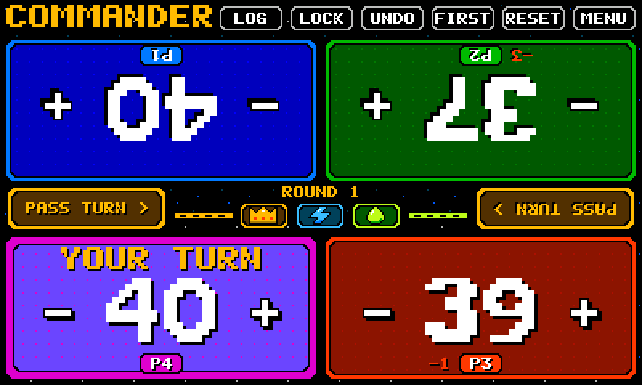

# Visor de Vida MTG

Contador de vida para **Magic: The Gathering** (Commander e Standard, 1 a 4 jogadores) numa placa
**ESP32-S3 com tela touch de 4,3" (800×480)**, programada na IDE do Arduino.



## Funções

- Vida em números grandes, com + e − (segurar repete); os painéis de cima ficam girados 180° para quem está do outro lado da mesa.
- Marcadores de veneno e energia, dano de comandante (21 de um mesmo comandante elimina) e eliminação automática.
- Barra superior: histórico (LOG), trava contra toques (LOCK), desfazer (UNDO), sorteio de quem começa (FIRST), RESET e MENU.

## Hardware

| Item | Detalhes |
|---|---|
| Placa | Sunton **ESP32-8048S043C** — ESP32-S3, 16 MB de flash, 8 MB de PSRAM, tela IPS 4,3" 800×480, touch capacitivo GT911 |
| Cabo | USB-C **de dados** |

## Estrutura

| Pasta | Conteúdo |
|---|---|
| `etapas/` | O projeto construído em etapas, cada uma com código comentado, guia (`README.md`) e print. A versão completa é `etapas/etapa07a11_visor/`. |
| `simulador/` | Roda os programas das etapas numa janela 800×480 no PC (Linux), com o mouse fazendo o papel do dedo. |
| `docs/fonte/` | Script que gera o diário do projeto (`Diario_do_Projeto.pdf`). |
| `rascunho/` | Primeiro rascunho do firmware (substituído por `etapas/etapa07a11_visor/`). |

## Rodar no simulador (Fedora)

```bash
sudo dnf install gcc-c++ make cmake git sdl2-compat-devel
cd simulador
git clone --depth 1 https://github.com/lovyan03/LovyanGFX.git
cmake -B build -DSKETCH=../etapas/etapa07a11_visor/etapa07a11_visor.ino
cmake --build build -j
./build/simulador
```

## Gravar na placa

Arduino IDE 2 + pacote **esp32** (Espressif) + biblioteca **LovyanGFX**. Em *Ferramentas*:
Placa **ESP32S3 Dev Module**, Flash Size **16MB**, PSRAM **OPI PSRAM**. Detalhes em `etapas/etapa03_ola/README.md`.

## Atualizar a pasta local

As mudanças são enviadas direto para este repositório. Para trazer a versão mais recente para o computador:

```bash
cd ~/Desktop/"Projeto Arduíno"
git pull
```

## Status

Etapas 3 a 11 compilam para a placa e foram testadas no simulador; falta testar na placa de verdade.
Próximos passos: salvar a partida ao desligar, bateria e case, e integração com o [Playgroup.gg](https://playgroup.gg).
O andamento completo está em `Diario_do_Projeto.pdf`.
