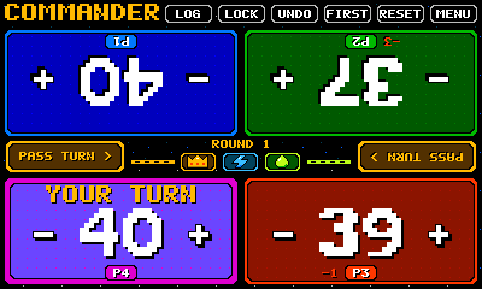
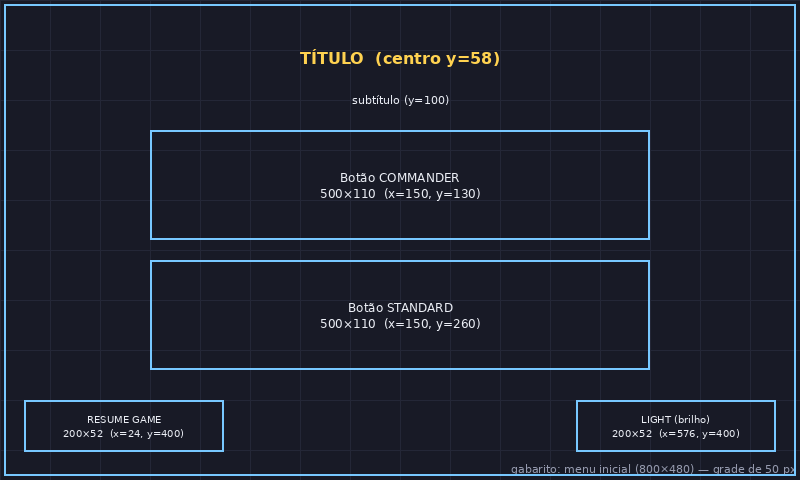
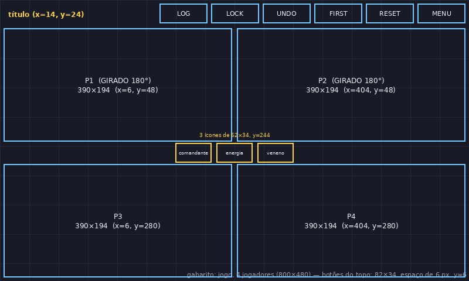
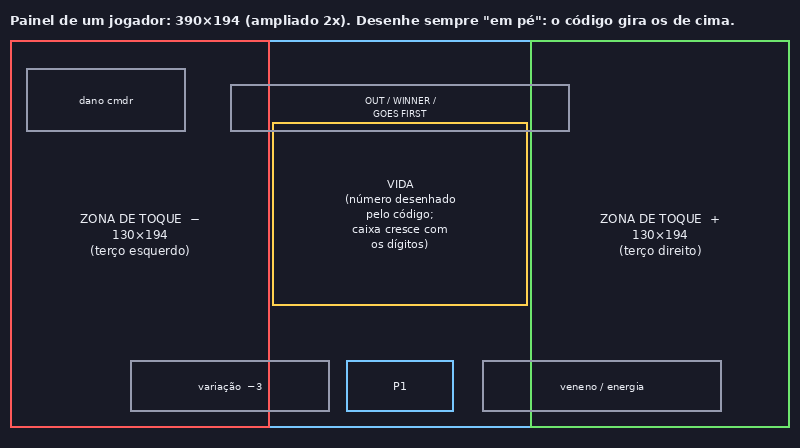

# Briefing de arte — Visor de Vida MTG

Olá! Este documento explica tudo o que você precisa para criar a arte das telas do **Visor de Vida MTG**:
um contador de vida para partidas de *Magic: The Gathering*, que roda numa pequena tela touch colocada no
meio da mesa. A arte atual é só provisória (feita em código); a ideia é trocar por uma arte sua.

## 1. A tela

| | |
|---|---|
| **Resolução** | **800 × 480 pixels**, na horizontal (paisagem) |
| **Tamanho** | 4,3 polegadas na diagonal (cerca de 9,5 × 5,7 cm) |
| **Densidade** | ~217 pixels por polegada: **1 mm ≈ 8,5 px** |
| **Cores** | 65 mil cores (16 bits). Degradês muito suaves podem aparecer "em faixas" |
| **Toque** | Capacitivo (o dedo, igual a um celular) |

**Como ela é usada:** fica deitada no meio da mesa, vista a uns 60–80 cm, de vários ângulos, por até 4 pessoas.
Os dois jogadores do lado de lá da mesa leem a tela **de cabeça para baixo**, por isso os painéis deles são girados 180° pelo programa.

Isso pede:
- **Contraste alto** e formas simples. Nada de linhas de 1 px nem detalhes muito finos.
- Textos com pelo menos **16 px de altura**; números da vida o maior possível.
- **Áreas de toque com pelo menos 60 × 60 px** (≈ 7 mm).
- Cores chapadas ou degradês "fortes"/com textura, em vez de degradês sutis.
- Não diferenciar coisas só por cor (ex.: vermelho x verde para − e +): use forma ou símbolo também.

## 2. O que é arte e o que é código

| Fica com o código (não precisa desenhar) | Vem da arte |
|---|---|
| Números que mudam: vida, veneno, energia, dano | Fundos das telas |
| Textos que mudam: histórico, "P1 > P2", avisos | Molduras dos painéis e botões (normal, selecionado, desativado) |
| Girar os painéis de cima | Ícones (comandante, energia, veneno) |
| | Títulos e logotipo |
| | (Opcional) uma fonte para os números, ver item 5 |

**Desenhe tudo "em pé".** O programa gira sozinho os painéis dos jogadores de cima.

## 3. Medidas (não mudar sem combinar)

Os gabaritos abaixo estão em tamanho real, com as posições em pixels; use-os como camada de guia no seu programa de desenho.
As medidas estão amarradas às áreas de toque do programa. Se quiser outro layout, sem problema: mande o desenho e eu ajusto o código.

No painel de cada jogador, o **terço esquerdo inteiro é o botão −** e o **terço direito é o botão +**.
O centro fica livre para o número da vida.

## 4. Lista de peças

| Peça | Tamanho (px) | Versões |
|---|---|---|
| Fundo do menu inicial | 800 × 480 | — |
| Fundo da tela de configuração | 800 × 480 | — |
| Botão grande (COMMANDER, STANDARD) | 500 × 110 | normal, pressionado |
| Botão médio (BACK, RESUME, LIGHT, YES, NO...) | 200 × 52 | normal, selecionado, desativado |
| Botões do topo (LOG, LOCK, UNDO, FIRST, RESET, MENU) | 82 × 34 cada | normal, ativo (LOCK ligado), desativado (UNDO sem nada para desfazer) |
| Painel do jogador (4 jogadores) | 390 × 194 | normal e eliminado, para P1 a P4 (ou um painel neutro + etiqueta colorida) |
| Painel largo (2 ou 3 jogadores) | 788 × 194 | normal, eliminado |
| Painel único (1 jogador) | 788 × 384 | normal, eliminado |
| Etiqueta do jogador (P1–P4) | 54 × 26 | uma cor por jogador |
| Ícones: comandante, energia, veneno | 40 × 24 (botão do meio) e 18 × 18 (dentro do painel) | — |
| Botões de ícone do meio | 62 × 34 | normal |
| Caixa de confirmação ("RESET GAME?") | 460 × 220 | — |
| Fundos das telas de veneno/energia, comandante e histórico | 800 × 480 | — (opcional) |
| Tela de abertura | 800 × 480 | — (opcional) |

**Dica:** quanto mais peças forem reaproveitadas (a mesma moldura para todos os botões médios, por exemplo), melhor.

## 5. Formato de entrega

- **PNG**, no **tamanho exato em pixels** da tabela (sem "@2x"; a tela não tem escala).
- **Transparência:** pode usar, mas com borda "dura". Evite sombras e brilhos semitransparentes por cima de coisas que mudam (números, outros painéis). Se tiver sombra, entregue a peça já com o fundo.
- **Nomes de arquivo** sem espaço nem acento: `painel_p1_normal.png`, `botao_topo_undo_desativado.png`.
- **Arquivo-fonte** em camadas (Figma, Photoshop, Krita, Affinity...).
- **Um mockup de cada tela completa** (800 × 480) com números de exemplo, mostrando como tudo se encaixa.
- **Fonte para os números (opcional):** arquivo `.ttf`/`.otf` com licença que permita incorporar em software. Precisa ter os dígitos 0–9 e os sinais + e −.
- **Peso:** há espaço para uns 2 MB de imagens no programa. Fundos com muito detalhe fotográfico pesam mais; texturas simples e áreas chapadas pesam menos.

## 6. Direitos e marcas

- A arte deve ser **original**. Não use arte de cartas, símbolos oficiais de mana, o logotipo do *Magic* ou personagens: são propriedade da Wizards of the Coast.
- Fontes e texturas de terceiros só com licença que permita uso em software.
- O projeto fica num repositório no GitHub: combine comigo os créditos e a permissão de uso da arte.

## 7. Checklist antes de entregar

- [ ] Todas as peças nos tamanhos exatos da tabela.
- [ ] Nenhuma área de toque menor que 60 × 60 px.
- [ ] Legível a 70 cm de distância (teste: veja o mockup no celular, a um braço de distância).
- [ ] Painéis desenhados "em pé".
- [ ] Sem semitransparência por cima de áreas que mudam.
- [ ] Arquivo-fonte em camadas + mockups das telas.

Depois da entrega, eu coloco a arte no programa e mando de volta os prints do simulador para conferirmos juntos.
