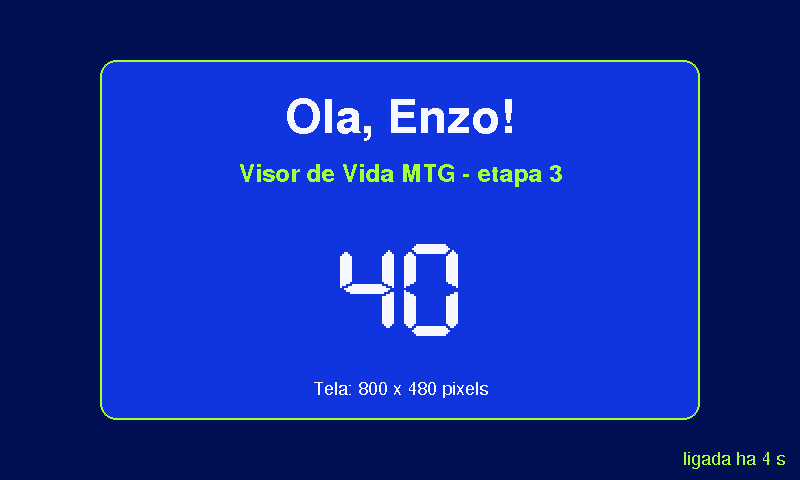

# Etapa 3 — Primeiro programa: acender a tela e escrever um texto

**Objetivo:** confirmar que tudo funciona de ponta a ponta (IDE, placa, upload e tela) com o menor programa possível.

**O que o programa faz:** pinta o fundo de azul, desenha um painel com borda verde-limão, escreve "Ola, Enzo!",
mostra um "40" em estilo display de 7 segmentos e o tamanho da tela. No canto inferior direito, um contador
"ligada ha N s" prova que o `loop()` está rodando.



## Arquivos

| Arquivo | O que faz |
|---|---|
| `etapa03_ola.ino` | O programa (comentado linha a linha). |
| `placa.h` | Escolhe a tela: a placa de verdade ou o simulador do PC. |

## Conceitos desta etapa

- **`setup()`** roda uma vez quando a placa liga; **`loop()`** roda para sempre depois disso.
- **Coordenadas:** o ponto (0, 0) é o canto superior esquerdo; x vai até 799 (direita) e y até 479 (baixo).
- **Cores** no formato `0xRRGGBB` (ex.: `0xA6FF3C` = verde-limão).
- **`setTextDatum(middle_center)`:** o (x, y) do `drawString` passa a ser o centro do texto.
- **`millis()`:** milissegundos desde que a placa ligou; serve para fazer algo "a cada 1 segundo" sem travar o programa.
- **Monitor Serial:** mensagens que a placa manda para o computador (`Serial.println`). Ótimo para depurar.
- As fontes da biblioteca **não têm acentos**: por isso "Ola" e não "Olá".

## A) Testar agora, sem a placa (simulador)

Siga o `simulador/README.md`. Resumo:

```bash
cd ~/Desktop/"Projeto Arduíno"/simulador
cmake -B build -DSKETCH=../etapas/etapa03_ola/etapa03_ola.ino
cmake --build build -j
./build/simulador
```

**Exercício:** troque o texto "Ola, Enzo!" e a cor `COR_PAINEL`, recompile e veja a diferença.

## B) Quando a placa chegar

1. **Arduino IDE 2**: baixe em arduino.cc/en/software (no Linux, o AppImage).
2. **Placas ESP32**: em *Ferramentas → Placa → Gerenciador de Placas*, procure **esp32** (da Espressif Systems) e instale.
   Se não aparecer, adicione em *Arquivo → Preferências → URLs adicionais*:
   `https://espressif.github.io/arduino-esp32/package_esp32_index.json`
3. **Biblioteca**: em *Ferramentas → Gerenciar Bibliotecas*, procure **LovyanGFX** e instale.
4. **Permissão da porta USB (Linux, uma vez só)**: `sudo usermod -aG dialout $USER`, depois saia e entre de novo na sessão.
5. Abra `etapa03_ola.ino` e configure em *Ferramentas*:
   - Placa: **ESP32S3 Dev Module**
   - Flash Size: **16MB (128Mb)**
   - PSRAM: **OPI PSRAM** (obrigatório: a tela usa essa memória)
   - Porta: a que aparecer ao plugar a placa (geralmente `/dev/ttyUSB0`)
6. Clique em **Carregar** (seta →). Depois abra o **Monitor Serial** em **115200** baud.

**Deu certo se:** a tela mostra o mesmo que o simulador, o contador do canto sobe a cada segundo
e o Monitor Serial mostra "Pronto!" e "ligada ha N s".

## Se der problema

| Sintoma | O que fazer |
|---|---|
| A IDE não acha a porta | Troque o cabo (pode ser só de carga); confira o passo 4. |
| Erro no upload ("Failed to connect") | Segure o botão **BOOT** da placa, aperte e solte **RESET**, solte o BOOT e tente de novo. |
| Tela preta ou piscando | Confira **PSRAM = OPI PSRAM**. Aperte RESET depois do upload. |
| Cores trocadas (azul aparece vermelho) | Anote e me avise: ajustamos a ordem das cores na configuração da tela. |
| Monitor Serial com caracteres estranhos | Ajuste a velocidade para **115200**. |
