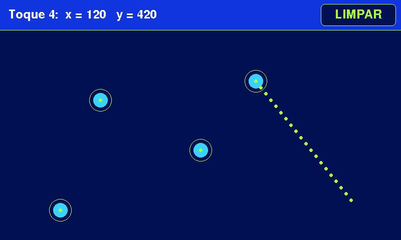

# Etapa 4 — Testar o touch

**Objetivo:** confirmar que o touch funciona e entender como ler um toque.

**O que o programa faz:** cada toque desenha um círculo e mostra as coordenadas (x, y) na barra de cima.
Arrastar o dedo deixa um rastro. O botão **LIMPAR** apaga tudo. No simulador, o clique do mouse é o dedo.

## Conceitos desta etapa

- **`lcd.getTouch(&x, &y)`** devolve `true` se há um dedo na tela e preenche `x` e `y` com a posição.
- **"Acabou de encostar" x "continua encostado":** o `loop()` roda ~100 vezes por segundo, então um toque
  dura várias voltas. Guardamos na variável `dedoNaTela` se havia dedo na volta anterior:
  `tocando && !dedoNaTela` = toque novo (acontece uma vez); `tocando && dedoNaTela` = arrastando.
- **Botão** = um retângulo (`struct Botao`) e a função `dentroDe()`, que diz se o toque caiu dentro dele.

## Testar

- Simulador: `cmake -B build -DSKETCH=../etapas/etapa04_touch/etapa04_touch.ino`, `cmake --build build -j`, `./build/simulador`
- Placa: abra `etapa04_touch.ino` na IDE e carregue (mesmas configurações da etapa 3).

**Deu certo se** o círculo aparece exatamente embaixo do dedo. Na placa, se o ponto aparecer espelhado
ou deslocado, anote onde tocou e onde apareceu e me avise: o ajuste é na configuração do touch.

**Exercício:** mude a cor do círculo conforme a metade da tela (esquerda/direita) em que o toque caiu.
