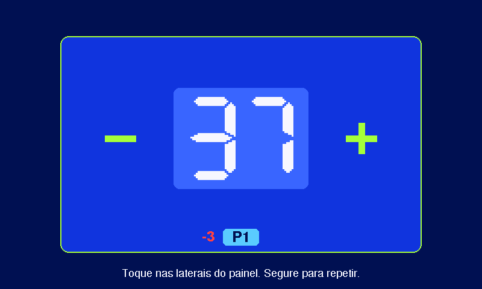
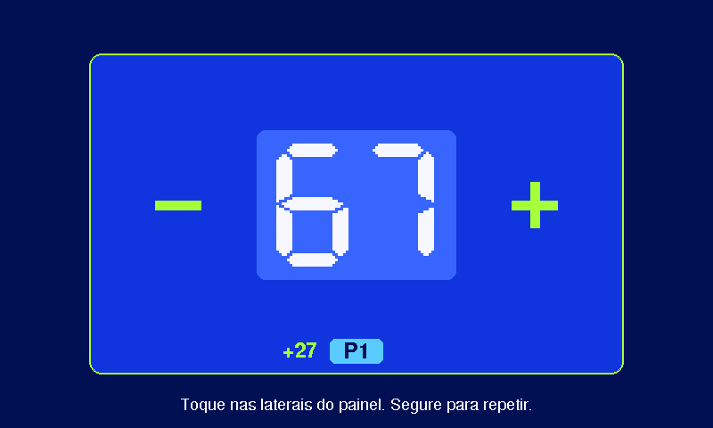

# Etapa 5 — Um painel de jogador com a vida e os botões + e −

**Objetivo:** o primeiro pedaço "de verdade" do visor: um jogador, sua vida e os botões.

**O que o programa faz:** um painel com a vida em números grandes. Tocar no terço esquerdo tira 1, no terço
direito soma 1. Segurar repete; depois de 10 repetições, muda de 5 em 5. Ao lado da etiqueta "P1" aparece a
variação recente (ex.: "-3"), que some depois de 3 segundos.

 

## Conceitos desta etapa

- **Sprite ("tela invisível"):** desenhar direto no display faz a tela piscar, porque você vê cada etapa do desenho
  (fundo, painel, número...). Com o sprite, desenhamos o quadro inteiro na memória e copiamos tudo de uma vez
  (`tela.pushSprite(0, 0)`). Um quadro de 800×480 ocupa 768 KB: na placa, ele fica na PSRAM (`setPsram(true)`).
- **Redesenhar só quando muda:** a variável `precisaDesenhar` evita trabalho à toa.
- **Segurar para repetir:** quando o dedo encosta, marcamos a hora da primeira repetição (`millis() + 450`).
  Enquanto o dedo continuar no mesmo botão, repetimos a cada 140 ms.
- **Variação recente:** toques dentro de 3 s se somam (`variacao`); depois disso, a contagem recomeça.

## Testar

- Simulador: `cmake -B build -DSKETCH=../etapas/etapa05_painel/etapa05_painel.ino`, `cmake --build build -j`, `./build/simulador`
- Placa: abra `etapa05_painel.ino` na IDE e carregue.

**Exercício:** faça a vida ficar vermelha quando estiver abaixo de 10.
