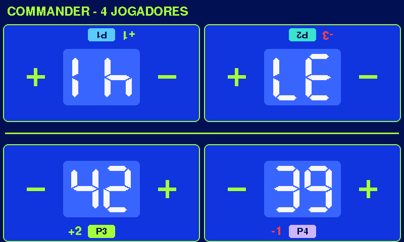

# Etapa 6 — Quatro painéis, com os dois de cima girados 180°

**Objetivo:** a mesa de 4 jogadores. Quem está do outro lado da mesa lê o próprio painel de frente.

**O que o programa faz:** P1 e P2 em cima (de cabeça para baixo), P3 e P4 embaixo. Cada painel tem sua vida,
seus botões e sua variação recente. No print, P2 levou −3 e P4 −1; P1 ganhou +1 e P3 +2.

## Conceitos desta etapa

- **`struct Jogador` + array `jog[4]`:** cada jogador guarda posição na tela, se está girado, vida e variação.
  Um único `desenhaPainel(j)` serve para os quatro.
- **Dois sprites:** `painel` (390×194) desenha um jogador por vez; ele é copiado para `tela` (800×480) na posição
  do jogador; no fim, `tela` vai para o display.
- **Girar 180° = inverter a ordem dos pixels.** O sprite é uma lista de pixels, linha por linha. Invertendo a lista
  (`std::reverse`), o primeiro pixel (canto superior esquerdo) vira o último (canto inferior direito):
  é exatamente uma rotação de 180°. Desenhamos sempre "em pé" e giramos no fim.
- **Toque num painel girado:** para quem está do outro lado, a esquerda e a direita trocam. Em `achaBotao()`,
  a posição do toque dentro do painel é espelhada (`lx = p.w - 1 - lx`) antes de decidir se foi − ou +.

## Testar

- Simulador: `cmake -B build -DSKETCH=../etapas/etapa06_quatro_paineis/etapa06_quatro_paineis.ino`, `cmake --build build -j`, `./build/simulador`
- Placa: abra `etapa06_quatro_paineis.ino` na IDE e carregue.

**Exercício:** gire também o título "COMMANDER - 4 JOGADORES" para quem está do outro lado (dica: desenhe num sprite pequeno e inverta).
