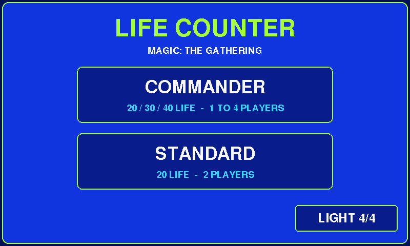
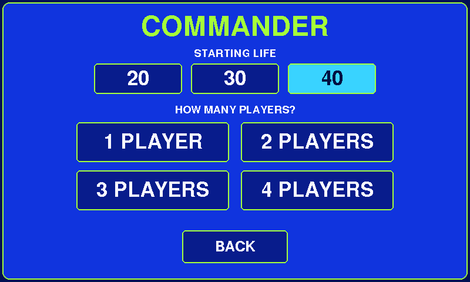
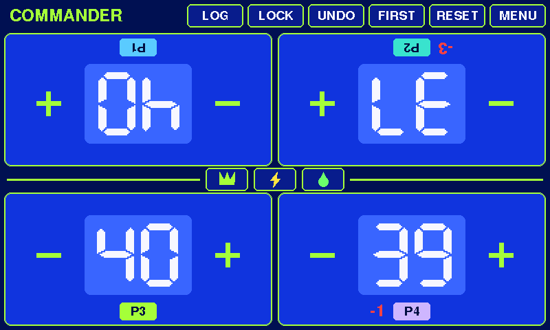
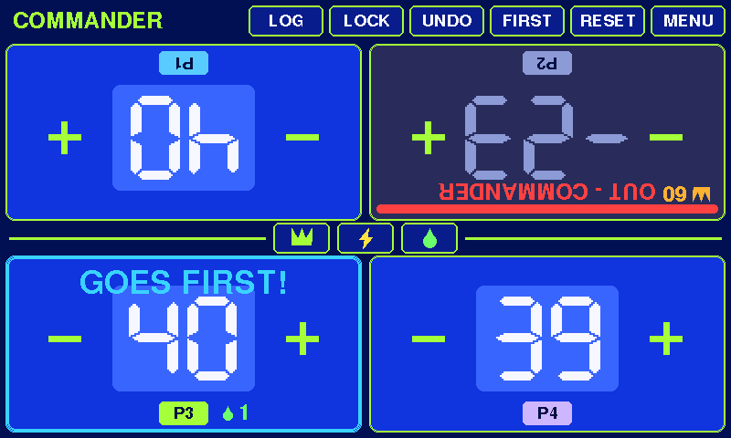
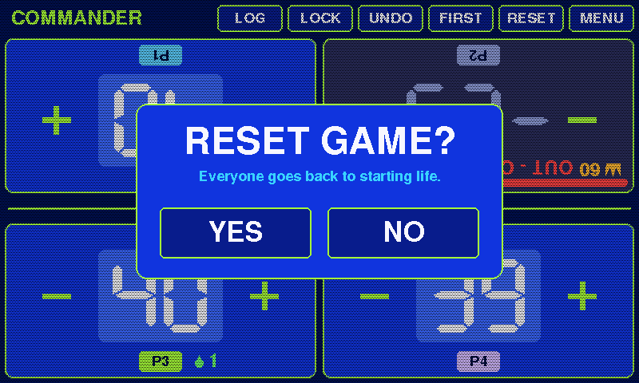
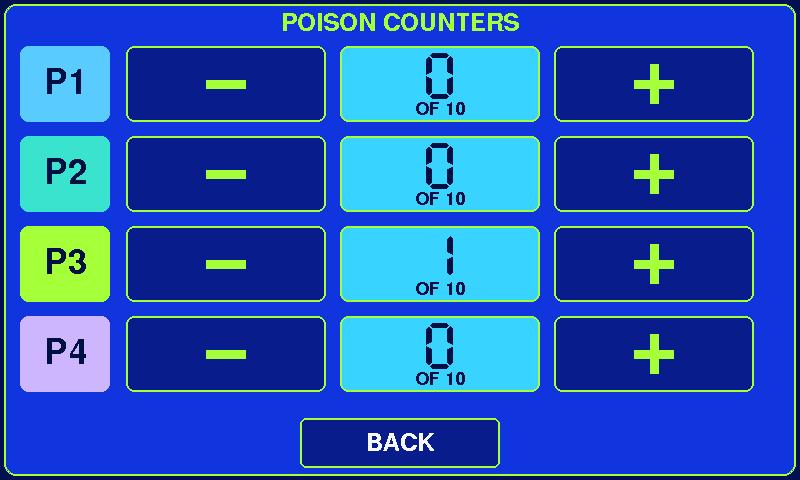
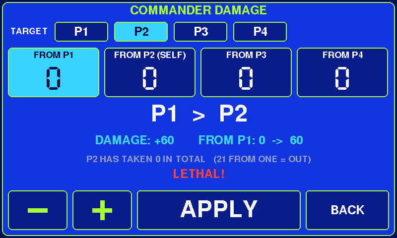
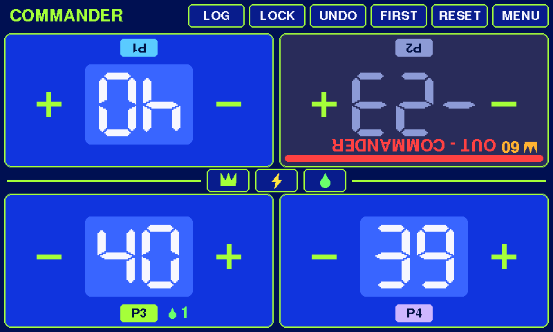
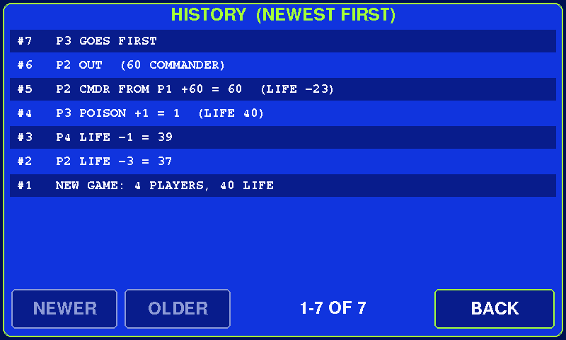

# Etapas 7 a 11 — O visor completo

Aqui as etapas 4 a 6 viram o programa inteiro do contador, organizado em arquivos.
Tudo foi testado no simulador e compila para a placa; **falta rodar na placa de verdade**.

| Tela | |
|---|---|
| Menu e configuração (etapa 7) |   |
| Jogo, sorteio do FIRST e confirmação do RESET (etapa 8) |    |
| Veneno (etapa 9) |  |
| Dano de comandante (etapa 10) |   |
| Histórico (etapa 11) |  |

## Como o código está dividido

| Arquivo | Papel |
|---|---|
| `etapa07a11_visor.ino` | Liga a tela, cria o sprite e repassa cada toque para a interface. Bem curto. |
| `game.h` / `game.cpp` | **As regras** (classe `mtg::Game`): vida, veneno, energia, dano de comandante, eliminação, UNDO e histórico. Não sabe nada de tela. |
| `ui.h` / `ui.cpp` | **A interface** (classe `App`): desenha cada tela e decide o que cada toque faz. |
| `placa.h` | Escolhe entre a placa de verdade e o simulador do PC. |

Separar regras e interface é o mesmo princípio de separar domínio e controller num back-end: dá para mudar a
tela sem mexer nas regras, e testar as regras sem tela.

## Onde está cada etapa no código

### Etapa 7 — Menu inicial e configuração do Commander
- `App::renderMenu()`: botões COMMANDER, STANDARD, RESUME GAME (volta para a partida em andamento) e LIGHT (brilho).
- `App::renderSetup()`: vida inicial (20/30/40) e número de jogadores (1 a 4).
- `App::layoutPanels()`: posição dos painéis para 1, 2, 3 ou 4 jogadores (os de cima, girados).
- Ideia-chave: **telas como estados** (`enum class Screen`). O `render()` desenha a tela atual; um toque pode mudar de tela.

### Etapa 8 — Barra superior: LOG, LOCK, UNDO, FIRST, RESET, MENU
- `App::topBar()` desenha os botões; `App::perform()` diz o que cada um faz.
- **LOCK** trava os painéis contra toques acidentais. **FIRST** sorteia quem começa (o painel pisca e mostra "GOES FIRST!").
- **RESET** e **MENU** pedem confirmação (`App::renderConfirm()`).
- **UNDO** (`Game::undo()`): antes de cada ação, o jogo guarda uma "foto" do estado (`pushUndo()`); desfazer é voltar para a última foto.

### Etapa 9 — Veneno e energia
- `App::renderCounters()`: uma linha por jogador com −, valor e +. A mesma tela serve para veneno (gota) e energia (raio).
- 10 de veneno elimina (`POISON_LETHAL` em `game.h`).

### Etapa 10 — Dano de comandante
- `App::renderCmdr()`: escolhe o alvo (TARGET) e de qual comandante veio o dano (FROM). Mostra quanto já levou e avisa "LETHAL!".
- `Game::applyCommander()`: soma o dano no comandante **e** tira a mesma quantia de vida.
- 21 de um mesmo comandante elimina (`CMDR_LETHAL`). O painel do eliminado fica escuro, com faixa vermelha e o motivo.

### Etapa 11 — Histórico
- `App::renderLog()`: 10 linhas por página, a mais recente primeiro, com NEWER/OLDER.
- `Game::change()` + `Game::flush()`: toques seguidos no mesmo contador, em até 3 s, viram **uma** linha (ex.: "P2 LIFE -3 = 37").
- O histórico guarda até 200 linhas num buffer circular (`log_` em `game.h`).

## Testar

- Simulador: `cmake -B build -DSKETCH=../etapas/etapa07a11_visor/etapa07a11_visor.ino`, `cmake --build build -j`, `./build/simulador`
- Placa: abra `etapa07a11_visor.ino` na IDE (os outros arquivos da pasta abrem como abas) e carregue.

## O que ainda falta (etapa 12, precisa da placa)
- Salvar a partida na memória interna para não perder se a bateria acabar.
- Bateria e case.
